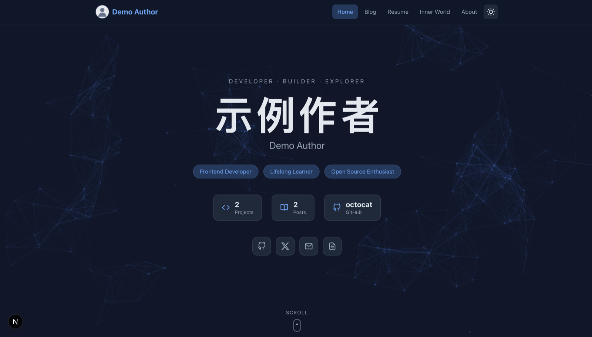
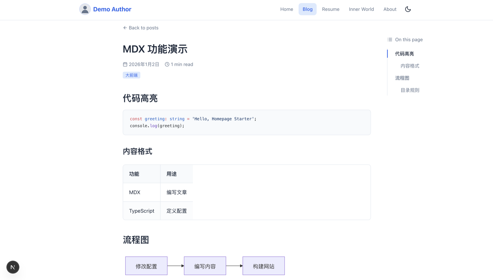

<div align="center">

# Homepage Starter

A personal homepage & blog template built with Next.js 16 · React 19 · TypeScript · Tailwind CSS

English · [简体中文](README.md)

[](https://nextjs.org)
[](https://react.dev)
[](https://www.typescriptlang.org)
[](https://tailwindcss.com)
[](https://nodejs.org)

</div>

Homepage Starter is a personal homepage and blog template built with Next.js 16, React 19, and Tailwind CSS. It ships with a complete set of sections — an MDX blog, code highlighting, light/dark themes, a resume page, and a bookshelf. Author info, posts, and navigation all live in standalone config files, so you can customize the whole site without touching a single component. Whether you are preparing for job hunting, writing regularly as a developer, or want a homepage you can maintain for years to come, it aims to provide an out-of-the-box, easy-to-customize environment for writing and publishing.

## 🖼️ Preview

**Home (light theme)** — The first screen on a particle-mesh background: author info, identity tags, project / post / GitHub stat cards, and social links.

<div align="center">
  
</div>

**Dark theme & blog post page** — One-click theme switching across the whole site; the blog page comes with Shiki code highlighting, Mermaid diagrams, and a table of contents generated from the post's actual heading levels.

| Dark theme | Blog post page |
| --- | --- |
|  |  |

## ✨ Features

- **MDX blog** — Write posts in MDX, with GFM tables, task lists, and other extended syntax
- **Code highlighting** — Shiki + rehype-pretty-code, highlighted at build time
- **Mermaid diagrams** — Just write a ```` ```mermaid ```` code block in your post
- **Table of contents** — Auto-generated from the post's actual heading levels
- **Light / dark theme** — One-click toggle via next-themes, follows the system
- **Reading experience** — Reading-time estimates and click-to-zoom images
- **Resume page** — TypeScript-driven data, one edit updates everything
- **Bookshelf & reading log** — A dedicated section for your reading history
- **Projects & friend links** — All managed from a single config file
- **Particle background & motion** — particles.js mesh + framer-motion page transitions
- **Comments & analytics (optional)** — Giscus, Umami, and Vercel Analytics, off by default

## 🚀 Quick Start

Requires Node.js 20.9 or higher.

```bash
git clone https://github.com/Jaxon1216/homepage-starter.git
cd homepage-starter
npm ci
npm run dev
```

Open http://localhost:3000 .

## 🧭 Customizing Content

| File | Contents |
| --- | --- |
| `lib/site-config.ts` | Name, domain, avatar, navigation, social links, projects & friend links |
| `content/profile/resume.ts` | Resume data & versions |
| `app/about/AboutContent.tsx` | Skills & copy for the About page |
| `content/posts/` | Blog posts in MDX |
| `content/reading/` | Reading log |
| `public/` | Avatar & post images |

Conventions for posts:

- `tags` accepts only `大前端`, `agent`, `学生思维`, `服务端` (validated by `lib/mdx.ts`; an invalid value fails dev / build instead of being silently dropped)
- The cover defaults to the first image in the post body; set `cover: /images/xxx.png` in frontmatter to override, or `cover: false` to hide it
- Use `#` for main sections and `##` for subsections — avoid skipping levels

> `hidden` on resume entries only controls display. Treat all published content as public — never put confidential data in it.

## ☁️ Deployment

- Works on any platform that supports Next.js, or a self-hosted Node server: `npm run build && npm run start`
- Static export is not configured — GitHub Pages compatibility is not guaranteed
- Remember to replace the demo domain with your own

## 🔌 Third-party Integrations

Umami, Vercel Analytics, and Giscus are off by default. Copy `.env.example` to `.env.local` and fill in your own config — see the [integration guide](docs/integrations.md). Public variables are exposed to the browser; never put database passwords or server-side secrets in them.

## ✅ Checks

```bash
node --test tests/*.test.mjs
npm run lint
npm run build
npm run start
```

## 📌 Before Publishing

- Replace all demo content and assets
- Turn off the integrations you don't need
- Never publish `.env.local` or build artifacts

## License

No open-source license has been selected yet — pick and add one (e.g. MIT) before publishing.
